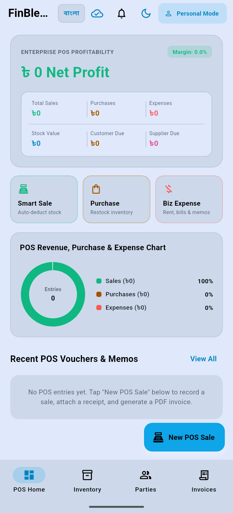

# FinBlend — All-in-One Financial Ecosystem
### Personal Finance, Group & Trip Budget Splitting & Enterprise POS Suite (`v2.0.0`)

[-3DDC84?style=for-the-badge&logo=android&logoColor=white)](https://github.com/RifatNSU701/Money-Management/releases/download/v2.0.0/FinBlend_v2.0.0.apk)

---

## Quick Access & Project Deliverables

For evaluators, instructors, and end users, all official `v2.0.0` deliverables are directly accessible below:

| Deliverable | Platform / Format | Direct Access Link | Description |
| :--- | :--- | :--- | :--- |
| **1. Live Web Application** | Web (Desktop & Mobile Browsers) | [**Launch FinBlend Web App**](https://moneymanagement-pearl.vercel.app/) | Instant browser access hosted on Vercel with SPA routing, tab persistence across reloads, and Google Drive sync. |
| **2. Android Application (`v2.0.0`)** | Android OS (`.apk` Installer) | [**Download `FinBlend_v2.0.0.apk` (GitHub)**](https://github.com/RifatNSU701/Money-Management/releases/download/v2.0.0/FinBlend_v2.0.0.apk)   [**View Release Notes**](https://github.com/RifatNSU701/Money-Management/releases/tag/v2.0.0)   [**Google Drive Mirror**](https://drive.google.com/file/d/1ViWQZjhSB_9vX4kPh2GAnoLuoSN--A8-/view?usp=drive_link) | Official standalone offline-first Android release (`v2.0.0`) with custom app icon, COGS POS, PIN lock, and PDF/CSV export. |
| **3. Video User Manual** | MP4 Annotated Walkthrough | [**Watch Instructional Video**](https://drive.google.com/file/d/1xAGm4Bgd1BapC8OjcKpkFr69sZAHVm3D/view?usp=drive_link) | Step-by-step narrated walkthrough demonstrating all core modules and workflows. |

---

## Table of Contents

1. [Overview & Problem Statement](#1-overview--problem-statement)
2. [Key Features (`v2.0.0`)](#2-key-features-v200)
3. [Application Interface Gallery](#3-application-interface-gallery)
4. [Complete User Manual (Step-by-Step Guide)](#4-complete-user-manual-step-by-step-guide)
5. [Access & Installation Guide](#5-access--installation-guide)
6. [System Architecture & Tech Stack](#6-system-architecture--tech-stack)
7. [Author, Course & Project Information](#7-author-course--project-information)
8. [License & Proprietary Rights](#8-license--proprietary-rights)
9. [Academic & Technical References](#9-academic--technical-references)

---

## 1. Overview & Problem Statement

Managing everyday finances typically forces users to juggle three or four disconnected applications: one for personal daily budgeting, another for splitting trip or meal costs with friends, and a third for handling small business sales, inventory, and customer dues. This fragmentation creates data silos, forces manual double-entry calculations, and locks private financial history inside third-party servers.

**FinBlend** unifies **Personal Finance & Wallet Tracking**, **Collaborative Group & Trip Budget Splitting**, and an **Enterprise Point-of-Sale (POS) & COGS Inventory Suite** inside a single cross-platform Flutter application. Built with an **offline-first architecture** and **user-owned Google Drive backups**, FinBlend delivers zero-latency daily accounting while keeping financial data strictly under the user's control across Android and Web.

---

## 2. Key Features (`v2.0.0`)

- **Authentication, Privacy & Security:** One-tap **Google OAuth 2.0** sign-in or local account registration (`+880` phone supported), **optional App PIN Lock**, **6-digit Recovery PIN** password reset, a **global Hide / Show Balances toggle** in the header, and typed `DELETE` confirmation for account wipes.
- **Personal Finance, Wallets & Budgets:** Unified transaction modal with wallet linking, **live post-transaction balance previews**, wallet-to-wallet transfers, exact decimal precision, **one-tap Repeat Last Transaction**, day-grouped transaction records with date-range/sorting/amount search, receipt attachments, monthly category budgets, and scheduled bills.
- **Group & Trip Budget Splitting Engine:** Create shared plans for tours, events, or shared meals with duplicate-member protection, equal or **custom/unequal split targets**, automatic **overpayment credit badges**, **pool shortfall allocation** when expenses exceed collected funds, and one-tap PDF settlement reports.
- **Enterprise POS, COGS Accounting & Party Ledger:** Switch seamlessly into **Business POS Mode** with product **cost-price tracking** for true COGS, net profit, and profit margin calculations, **stock-clamped checkout quantities**, Discount & VAT support, **A5 PDF / 80mm thermal receipts**, inventory stock-health alerts, and **partial or full party due collections** (`Due Collection` / `Supplier Payment`) that never inflate Total Sales.
- **Scope-Filtered Exports & Cloud Disaster Recovery:** Filter statements strictly by **`All`**, **`Personal`**, or **`POS`** across live previews, charts, **PDF**, **PNG**, **JPG**, and **`.csv` spreadsheets**. Back up and restore encrypted snapshots directly to personal **Google Drive** (with live sync spinners) or via local `.json` files.
- **Bilingual UI, Accessibility & Financial Tools:** Instant **English / বাংলা** switching, high-contrast **Light / Dark Mode**, active-tab persistence on web reloads, and the built-in **CalcBox Financial Calculator**.

---

## 3. Application Interface Gallery

| (a) Secure Login & OAuth 2.0 | (b) Enterprise POS & COGS Suite | (c) Group & Trip Budget Split | (d) Cloud Backup & Export |
| :---: | :---: | :---: | :---: |
|  |  |  |  |

---

## 4. Complete User Manual (Step-by-Step Guide)

> **Video Walkthrough:** Prefer watching a demonstration? [**Watch the Narrated Video User Manual**](https://drive.google.com/file/d/1xAGm4Bgd1BapC8OjcKpkFr69sZAHVm3D/view?usp=drive_link).

### Module 1: Getting Started, Authentication & Privacy Controls
1. **Open FinBlend:** Launch the installed Android app or open [https://moneymanagement-pearl.vercel.app/](https://moneymanagement-pearl.vercel.app/) in your browser.
2. **Sign In or Register:**
   - **Continue with Google (Recommended):** Tap **Continue with Google** and pick your Google account to authenticate via OAuth 2.0 and enable direct Google Drive cloud backups.
     > **First-Time Google Sign-In Note:** Because FinBlend is an independent production release not yet listed on Google's commercial verification directory, Google may show a *"Google hasn't verified this app"* notice on first login. Click **Advanced** → **Go to FinBlend (unsafe)** → **Continue** to proceed normally.
   - **Local Account Registration:** Switch to the **Register Account** tab, fill in your Full Name, Email, Mobile Number (`+880` validated), Date of Birth, Gender, Occupation, Address, and Password, then tap **Complete Registration**.
   - **Password Recovery:** If you forget a local account password, use the **Forgot Password** option with your **6-digit Recovery PIN** to reset access safely.
3. **Top-Bar Quick Controls (Available Everywhere):**
   - **Language (`বাংলা` / `EN`):** Tap to switch the entire interface between English and Bengali instantly.
   - **Hide / Show Balances (Eye Icon):** Tap to mask all currency balances and chart amounts on screen when using the app in public.
   - **Theme Toggle (Sun / Moon Icon):** Switch between Light Mode and Dark Mode.
   - **Google Drive Sync Icon & Notifications Bell:** Jump directly to cloud backup or view pending bills and collection reminders.
4. **Enable Optional App PIN Lock:** Open **Profile → Account & Settings → Security & Privacy**, enable **App PIN Lock**, and set your PIN so FinBlend prompts for verification every time the app opens.

---

### Module 2: Personal Finance, Wallets, Records & Budgets
1. **Home Dashboard:** Review your **Total Net Balance**, **Total Income**, **Total Expense**, and the **Cashflow & Category Breakdown Chart**. Empty categories cleanly display `0%` until transactions are logged.
2. **Manage Wallets & Transfers:**
   - Create and maintain multiple wallets (e.g., *Cash*, *Bank Account*, *bKash / Nagad*).
   - Use **Wallet Transfer** to move funds between two wallets without distorting your total income or expense analytics.
3. **Record a Transaction:**
   - Tap **+ Record Transaction** (or **Add Income** / **Add Expense**).
   - Select **Expense (-)** or **Income (+)** and link the source/destination **Wallet**—check the **live post-transaction balance preview** directly inside the modal before saving.
   - Pick a category, enter the exact amount (decimals such as `125.50` are preserved accurately), add an optional memo, and tap **Upload** to attach a photo or PDF receipt.
   - Tap **Save Transaction**.
   - **Quick Repeat:** Tap the **Repeat** button to instantly duplicate your last transaction with one tap for frequent daily purchases.
4. **Search, Group & Filter Records:**
   - Open the **Records** tab to view transactions neatly **grouped by day**.
   - Filter by **Date Range**, sort order, **Income / Expense**, **With Receipt / Memo**, keyword, or **exact/minimum/maximum Amount**.
5. **Budgets, Categories & Scheduled Bills:**
   - Open **Budgets** and tap **+ Set Category Budget** to define monthly spending limits and track utilization percentages.
   - Add upcoming **Scheduled Bills** with validated due dates so FinBlend flags upcoming payments in your notification bell.
   - Deleting a custom category safely protects existing historical records from breaking.

---

### Module 3: Group & Trip Budget Splitting
1. **Create a Shared Plan:** Open the **Groups** tab and tap **Create Trip / Split Plan**. Name your plan (e.g., *Sylhet Tour* or *Monthly Meal Pool*), enter the target budget, and add participants from your directory or manually (duplicate member names are automatically blocked).
2. **Set Equal or Custom Split Targets:**
   - Keep equal shares across all members, or assign **custom / unequal split targets** per member when participants owe different shares.
3. **Log Member Contributions:**
   - Inside a plan card, tap **Add / Update Member**, select an existing member chip (or add a new member), enter the amount paid (or tap **Full Target**), and tap **Save Member**.
   - If a member pays more than their target share, FinBlend automatically displays an **Overpayment Credit Badge** and adjusts remaining dues accurately.
4. **Log Group Expenses & Handle Shortfalls:**
   - Tap **Log Expense & Receipt** to record shared expenses deducted from the group pool.
   - If total group spending exceeds the collected cash pool, FinBlend automatically calculates and allocates the **Pool Shortfall** across members inside the settlement summary.
5. **Settle Up & Export PDF:**
   - Tap **Full Ledger, Charts & Settle Up** to inspect the **Group Pool Collection vs. Spending Chart**, per-member progress, credits, and dues.
   - Tap the **PDF icon** in the top-right corner to generate and share `FinBlend_Group.pdf` via WhatsApp, email, or local storage.

---

### Module 4: Enterprise Business POS, COGS Accounting & Party Ledger
1. **Switch to Business POS Mode:** Tap **Profile → Switch to Business POS Mode** (or tap **Biz POS** on the Home dashboard). Your active tab and mode persist even if you refresh the browser on web.
2. **Understand the POS COGS Profitability Dashboard:**
   - View live **Net Profit**, **Profit Margin (%)**, **Total Sales**, **Cost (COGS)**, **Business Expenses**, **Stock Value**, **Customer Due**, and **Supplier Due**.
   - Profitability follows standard accounting:
     `Net Profit = Gross Profit (Total Sales − Cost of Goods Sold) − Business Expenses`
3. **Add Products with Cost & Selling Prices (`Inventory` Tab):**
   - Tap **+ Add Product**, enter Product Name, **Cost Price (for COGS)**, **Selling Price**, and initial **Stock Quantity**.
   - Monitor the **Inventory Stock Health & Valuation Chart** to catch Low Stock and Out-of-Stock items early.
4. **Record Smart Sales, Purchases & Business Expenses:**
   - **Smart Sale:** Tap **Smart Sale / New POS Sale**, choose products from inventory (checkout quantity is automatically **clamped to available stock** so you cannot oversell), optionally apply **Discount** and **VAT (%)**, link a customer if selling on credit, and save.
   - **Purchase (Restock):** Log supplier restocks to increment stock levels and update inventory valuation.
   - **Biz Expense:** Record rent, utility bills, salaries, and other operating costs deducted from net profit.
5. **Track Customer Receivables & Supplier Payables (`Parties` Tab):**
   - Tap **+ Add Party** to register customers and suppliers with validated phone numbers and opening/pending dues.
   - When a customer pays back a balance (or you pay a supplier), tap the party and record a partial or full **`Due Collection`** / **`Supplier Payment`**. FinBlend logs per-party payment history and reminders **without artificially inflating Total Sales**.
6. **Generate POS Vouchers & Receipts (`Invoices` Tab):**
   - Filter vouchers by Sale, Purchase, or Expense and export/print formatted **A5 PDF invoices** or **80mm thermal receipts**.
   - Tap **Personal Mode** in the top-right corner whenever you want to switch back.

---

### Module 5: Scope-Filtered Exports, CalcBox & Google Drive Recovery
1. **Export Filtered Financial Statements (PDF, CSV, PNG, JPG):**
   - Open **Export / Statement** from the dashboard or settings.
   - Choose your exact data scope using the filter chips: **`All`**, **`Personal`**, or **`POS`**. The live summary card and donut chart immediately update to match your selected scope.
   - Export as a formatted **PDF Statement**, shareable **PNG / JPG image**, or **`.csv` spreadsheet** for Excel/Google Sheets analysis.
2. **Use CalcBox Financial Calculator:** Open **Account & Settings → CalcBox Financial Calculator**, enter Principal Amount, Annual Interest/Return Rate (%), and Duration (Years) to calculate projected maturity value.
3. **Back Up to Google Drive or Offline `.json`:**
   - Open **Account & Settings → Google Drive Direct Backup & Restore**.
   - Tap **Backup to Drive** (a live progress spinner displays while syncing) to upload an encrypted JSON snapshot directly to your personal Google Drive.
   - For offline storage, tap **Export `.json` File** or **Copy Backup JSON**.
4. **Restore Data & Safe Account Wipe:**
   - To permanently clear local data, tap **Delete Account** and type **`DELETE`** when prompted to prevent accidental loss.
   - To recover your entire Personal, Wallet, Group, and POS history on any device (even after a full wipe or reinstall), sign in, open **Google Drive Direct Backup & Restore**, and tap **Restore from Drive** (or paste/import your `.json` backup file).

---

## 5. Access & Installation Guide

- **Option A — Live Web Application (Instant Access):**
   1. Visit [**https://moneymanagement-pearl.vercel.app/**](https://moneymanagement-pearl.vercel.app/) on any desktop or mobile browser.
   2. Sign in with Google or create a local account to begin immediately.

- **Option B — Official Android APK (`v2.0.0`) Installation:**
   1. Download **`FinBlend_v2.0.0.apk`** directly from [**GitHub Releases (`v2.0.0`)**](https://github.com/RifatNSU701/Money-Management/releases/download/v2.0.0/FinBlend_v2.0.0.apk) (or via the [**Google Drive Mirror**](https://drive.google.com/file/d/1ViWQZjhSB_9vX4kPh2GAnoLuoSN--A8-/view?usp=drive_link)).
   2. Tap the downloaded `.apk` file on your Android phone.
   3. If prompted, enable **Install unknown apps** for your browser or file manager and complete installation.

---

## 6. System Architecture & Tech Stack

| Layer | Technology Used | Purpose |
| :--- | :--- | :--- |
| **Frontend Framework** | Flutter & Dart | Single codebase rendering native Android UI and responsive Web UI. |
| **Local Persistence** | SQLite & Shared Preferences | Offline-first transactional ledger guaranteeing zero-latency access and saved user preferences/tabs without internet. |
| **Authentication & Security** | Google OAuth 2.0, People API & Local PIN Auth | Token-based Google sign-in, optional App PIN Lock, and 6-digit local recovery PIN. |
| **Cloud Backup** | Google Drive REST API v3 | User-owned encrypted JSON snapshot storage and one-tap disaster recovery. |
| **Reporting & Export** | Dart `pdf`, `printing` & CSV Generator | On-device generation of scope-filtered PDF/PNG/JPG statements, `.csv` exports, group settlements, and A5/80mm POS receipts. |
| **Web Deployment** | Vercel (`vercel.json` SPA Routing) | Serverless frontend hosting with SPA URL rewrites and active-tab persistence across browser refreshes. |

---

## 7. Author, Course & Project Information

- **Project:** FinBlend (`v2.0.0`)
- **Instructor:** **Dr. Shafin Rahman**
- **Developer & Copyright Owner:** **Md Rifat Khan Rabbi**
- **Email:** `md.khanrabbi1324@northsouth.edu, corps.rifat@outlook.com`
- **GitHub:** [@RifatNSU701](https://github.com/RifatNSU701)
- **Portfolio:** [CRS](https://www.rifatkhan.tech/)

---

## 8. License & Proprietary Rights

**Copyright © 2026 Md Rifat Khan Rabbi. All Rights Reserved.**

FinBlend is **proprietary, closed-license software**—it is **not** open source.

- **Prohibited Without Written Permission:** Copying, modifying, redistributing, sublicensing, reverse-engineering, rebranding, or commercially using any source code, assets, logos, or compiled binaries from this repository is strictly prohibited.
- **Permitted Use:** End users may use the hosted web application and official unmodified `.apk` releases. North South University faculty and evaluators are granted read-only access solely for academic grading and verification.
- **Full Terms:** See the complete [`LICENSE`](./LICENSE) file in this repository. For commercial licensing or collaboration inquiries, contact `corps.rifat@outlook.com`.

---

## 9. Academic & Technical References

1. A. Biørn-Hansen, T.-M. Grønli, and G. Ghinea, "Cross-platform mobile app development: A comprehensive review," *IEEE Access*, vol. 8, pp. 170810–170827, 2020, doi: `10.1109/ACCESS.2020.3023742`.
2. G. Allen and M. Owens, *The Definitive Guide to SQLite*, 2nd ed. New York, NY, USA: Apress, 2010.
3. J. Richer and A. Sanso, *OAuth 2 in Action*. Shelter Island, NY, USA: Manning Publications, 2017.
4. Google Developers, "Google Drive REST API v3 Reference," 2026. [Online]. Available: https://developers.google.com/drive/api/v3/about-sdk
5. Google LLC, "Flutter — Build apps for any screen," 2026. [Online]. Available: https://flutter.dev/