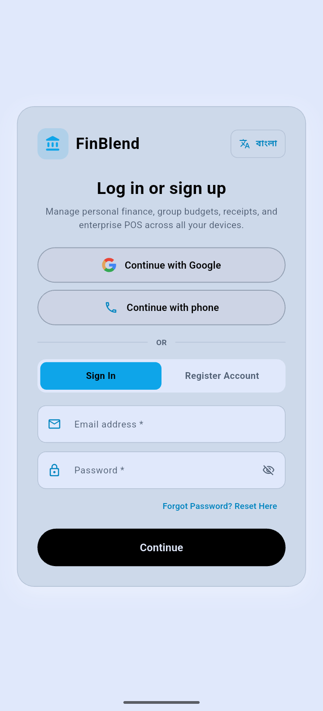
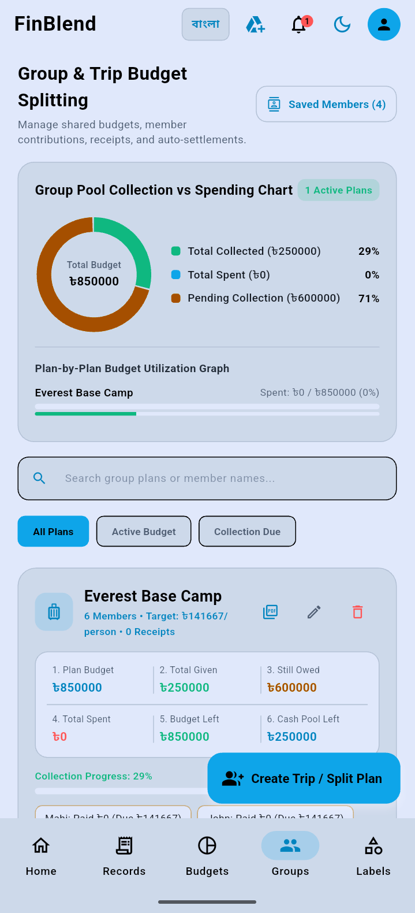
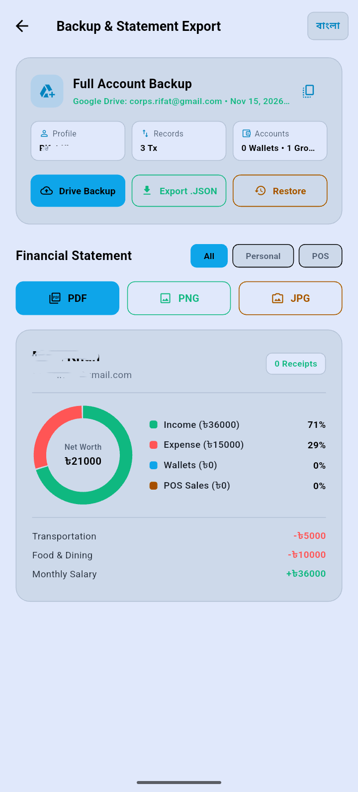

# FinBlend — All-in-One Financial Ecosystem
### Personal Finance, Group Trip Splitting & Enterprise POS Suite

**Course:** CSE299 (Junior Design Project) | **Section:** 01 | **Group:** 04  
**Institution:** Department of Electrical and Computer Engineering, North South University

---

## Quick Access & Project Deliverables

For evaluators, instructors, and end users, all project deliverables are accessible directly from the table below:

| Deliverable | Platform / Format | Direct Access Link | Description |
| :--- | :--- | :--- | :--- |
| **1. Live Web Application** | Web (Desktop & Mobile Browsers) | [**Launch FinBlend Web App**](https://moneymanagement-pearl.vercel.app/) | Instant browser access hosted on Vercel with URL routing and cloud sync. |
| **2. Android Application (`.apk`)** | Android OS (APK Installer) | [**Download APK (Google Drive)**](https://drive.google.com/file/d/1ViWQZjhSB_9vX4kPh2GAnoLuoSN--A8-/view?usp=drive_link)   [**Download APK (GitHub Release)**](../../releases/latest/download/FinBlend.apk) | Standalone offline-first Android package ready for installation. |
| **3. Video User Manual** | MP4 Annotated Walkthrough | [**Watch Instructional Video**](https://drive.google.com/file/d/1xAGm4Bgd1BapC8OjcKpkFr69sZAHVm3D/view?usp=drive_link) | Step-by-step voiceover demonstration of all 5 core modules. |

---

## Table of Contents

1. [Overview & Problem Statement](#1-overview--problem-statement)
2. [Key Features](#2-key-features)
3. [Application Interface Gallery](#3-application-interface-gallery)
4. [Complete User Manual (Step-by-Step Guide)](#4-complete-user-manual-step-by-step-guide)
5. [Installation & Setup Guide](#5-installation--setup-guide)
6. [System Architecture & Tech Stack](#6-system-architecture--tech-stack)
7. [Team & Individual Contributions](#7-team--individual-contributions)
8. [Academic & Technical References](#8-academic--technical-references)

---

## 1. Overview & Problem Statement

Managing everyday finances typically forces users to switch between three or four disconnected applications: one for personal daily budgeting, another for splitting trip or meal expenses with friends, and a third for managing small business sales and inventory. This fragmentation causes data silos, requires manual double-entry calculations, and often locks confidential financial history inside mandatory third-party servers.

**FinBlend** solves this fragmentation by combining **Personal Finance Tracking**, **Collaborative Group & Trip Budget Splitting**, and an **Enterprise Point-of-Sale (POS) & Inventory System** into a single, cross-platform ecosystem built with Flutter. Designed with an **offline-first architecture** and **user-controlled Google Drive backups**, FinBlend guarantees that users retain complete ownership and privacy over their financial records across Android and Web platforms.

---

## 2. Key Features

* **Secure Authentication & Local Profiles:** Sign in with one tap via **Google OAuth 2.0** or register a local profile using an email address or phone number (`+880` supported).
* **Personal Finance & Live Analytics:** Track total net balance (cash and wallets), inspect income-to-expense ratios via interactive donut charts, monitor category spending guardrails, attach photo/PDF receipts, and export financial statements in **PDF, PNG, or JPG** formats.
* **Group & Trip Budget Splitting Engine:** Create shared group budgets (such as tours, events, or hostel pools), track per-member target contributions vs. actual payments, log group expenses, and export automated peer-to-peer settlement reports in PDF format.
* **Enterprise POS & Inventory Suite:** Switch seamlessly into **Business POS Mode** to record smart sales (with automatic stock deduction), log restock purchases and business expenses, monitor inventory stock health (healthy vs. low/out-of-stock alerts), track customer receivables and supplier payables, and generate POS invoices.
* **User-Controlled Cloud Backup & Disaster Recovery:** Back up encrypted account snapshots directly to personal **Google Drive** storage via the Google Drive REST API v3, or export/import raw `.json` backup files locally. Even if an account or device is completely wiped, full financial history can be restored in seconds.
* **Bilingual Localization & Accessibility:** Switch between **English** and **Bengali (বাংলা)** in a single tap, toggle between **Light Mode** and **Dark Mode**, and plan investments with the built-in **CalcBox Financial Calculator**.

---

## 3. Application Interface Gallery

| (a) Secure Login & OAuth 2.0 | (b) Enterprise POS Suite | (c) Group & Trip Budget Split | (d) Cloud Backup & Export |
| :---: | :---: | :---: | :---: |
|  |  |  |  |

---

## 4. Complete User Manual (Step-by-Step Guide)

> **Video Walkthrough:** Prefer watching a demonstration? [**Click here to watch the narrated Video User Manual**](https://drive.google.com/file/d/1FTvEykIT6omRJSDe28UmEKj0b1L2ZLfh/view?usp=drive_link).

### Module 1: Authentication & Onboarding
1. **Launch FinBlend** on your Android device or open the [Web Application](https://moneymanagement-pearl.vercel.app/).
2. **Choose a Sign-In Method:**
   * **Google Sign-In (Recommended):** Tap **Continue with Google** and select your Google account to authenticate via OAuth 2.0 and enable cloud backup synchronization.
   * **Local Registration:** Tap the **Register Account** tab, enter your Full Name, Email Address, Mobile Number, Date of Birth, Gender, Occupation, Address, and Password, then tap **Complete Registration**.
3. **Language Selection:** Tap the **বাংলা / English** button in the top-right corner at any time to switch the interface language immediately.

### Module 2: Personal Finance Dashboard, Ledger & Budgets
1. **Dashboard Overview:** View your **Total Net Balance**, **Total Income**, **Total Expense**, and the **Cashflow & Category Analytics Chart** directly on the **Home** tab.
2. **Recording a Transaction:**
   * Tap **+ Record Transaction** (or the quick-action **Add Income** / **Add Expense** buttons).
   * Toggle between **Expense (-)** and **Income (+)**.
   * Select a category (e.g., *Food & Dining*, *Transportation*, *Shopping*, *Utilities & Rent*, or *Monthly Salary*).
   * Enter the amount in BDT, add an optional memo/reference note, and tap **Upload** to attach a receipt image or PDF from your device.
   * Tap **Save Transaction**.
3. **Auditing & Filtering Records:** Navigate to the **Records** tab on the bottom navigation bar to search transactions by keyword, filter by *Income Only*, *Expense Only*, or *With Receipt / Memo*, and inspect your audit trail.
4. **Setting Monthly Category Budgets:** Open the **Budgets** tab and tap **+ Set Category Budget** to establish monthly spending limits and monitor utilization percentages.
5. **Exporting Statements:** Tap **Export PDF** on the Home dashboard to export your financial statement as a **PDF**, **PNG**, or **JPG** document.

### Module 3: Group & Trip Budget Splitting
1. **Create a Shared Plan:** Navigate to the **Groups** tab at the bottom and tap **Create Trip / Split Plan** to set up a group budget (e.g., *Everest Base Camp*), defining the total budget target and member list.
2. **Log Member Contributions:**
   * Inside your active plan card, tap **Add / Update Member**.
   * Select an existing member chip or type a new participant's name.
   * Enter the amount contributed (or tap **Full Target** to mark their full share as paid) and tap **Save Member**.
   * The **Group Pool Collection vs. Spending Chart**, **Collection Progress**, and individual member due balances recalculate automatically.
3. **Log Group Expenses:** Tap **Log Expense & Receipt** on the plan card to record shared purchases deducted from the group cash pool.
4. **Export Settlement Report:** Tap **Full Ledger, Charts & Settle Up** to inspect individual target charts, member balances, and expense logs. Tap the **PDF icon** in the top-right corner of the modal to generate and share the `FinBlend_Group.pdf` settlement report via WhatsApp, email, or local storage.

### Module 4: Account Settings, CalcBox & Enterprise POS Mode
1. **Account & Preferences:** Tap the **Profile icon** in the top-right corner to open **Account & Settings**. Here you can toggle **App Language (English / বাংলা)**, switch **Appearance (Light Mode / Dark Mode)**, and inspect **Notifications & Alerts** for pending group collections or bills.
2. **CalcBox Financial Planner:** In Account & Settings, tap **CalcBox Financial Calculator** to compute investment maturity values based on Principal Amount, Annual Rate (%), and Duration (Years).
3. **Switching to Business POS Mode:**
   * Tap the **Switch to Business POS Mode** banner at the top of Account & Settings (or tap **Biz POS** on the Home dashboard).
   * **POS Home & Checkout:** View real-time **Net Profit**, **Total Sales**, **Purchases**, **Expenses**, and **Stock Value**. Tap **New POS Sale** (or the quick cards for *Smart Sale*, *Purchase*, or *Biz Expense*) to record a transaction, upload a memo, and sync.
   * **Inventory Management:** Open the **Inventory** tab and tap **+ Add Product** to track product quantities and monitor the *Inventory Stock Health & Valuation Chart* (Healthy Stock vs. Low/Out of Stock).
   * **Customer & Supplier Parties:** Open the **Parties** tab and tap **+ Add Party** to log customer receivables and supplier payables with phone numbers and pending due amounts.
   * **POS Vouchers & Invoices:** Open the **Invoices** tab to filter sales, purchase, and expense vouchers and generate printable POS invoices.
   * Tap **Personal Mode** in the top-right corner at any time to return to your personal dashboard.

### Module 5: Google Drive Backup, Account Wipe & Full Recovery
1. **Backing Up to Google Drive:**
   * Open **Account & Settings** and tap **Google Drive Direct Backup & Restore**.
   * Tap **Backup to Drive** and select your Google account when prompted. FinBlend uploads an encrypted JSON snapshot to your personal Google Drive and logs the timestamp.
   * Alternatively, tap **Export .json File** or **Copy Backup JSON** to save an offline backup manually.
2. **Restoring Data (Disaster Recovery):**
   * If you switch devices, reinstall the app, or tap **Delete Account** to permanently wipe local storage, sign back into FinBlend and open **Account & Settings > Google Drive Direct Backup & Restore**.
   * Tap **Restore from Drive** and authenticate your Google account (or paste a raw JSON string into the import box and tap **Import**).
   * All personal transactions, wallets, group split plans, and POS records are immediately restored to your dashboard.

---

## 5. Installation & Setup Guide

### For End Users (No Coding Required)

* **Option A — Web Application (Instant Access):**
  1. Visit [**https://moneymanagement-pearl.vercel.app/**](https://moneymanagement-pearl.vercel.app/) on any desktop or mobile browser.
  2. Sign in with Google or create a local account to begin immediately.

* **Option B — Android APK Installation:**
  1. Download `FinBlend.apk` from [**GitHub Releases**](../../releases/latest/download/FinBlend.apk) or the [**Google Drive Mirror**](https://drive.google.com/file/d/1ViWQZjhSB_9vX4kPh2GAnoLuoSN--A8-/view?usp=drive_link).
  2. Open the downloaded `.apk` file on your Android device.
  3. If prompted, enable *Install from Unknown Sources* in your Android browser/file manager settings and complete installation.

### For Developers (Building from Source)

1. **Prerequisites:** Ensure you have the [Flutter SDK](https://docs.flutter.dev/get-started/install) (3.x or higher) and Git installed on your machine.
2. **Clone the Repository:**
   <pre><code>git clone https://github.com/YOUR_USERNAME/YOUR_REPO_NAME.git
   cd YOUR_REPO_NAME</code></pre>
3. **Install Dependencies:**
   <pre><code>flutter pub get</code></pre>
4. **Run the Application:**
   <pre><code># Run on Chrome (Web)
   flutter run -d chrome

   # Build Release Android APK
   flutter build apk --release</code></pre>

---

## 6. System Architecture & Tech Stack

| Layer | Technology Used | Purpose |
| :--- | :--- | :--- |
| **Frontend Framework** | Flutter & Dart | Single codebase rendering native Android UI and responsive Web UI. |
| **Local Persistence** | SQLite & Local Storage | Offline-first transactional ledger guaranteeing zero-latency access without internet. |
| **Authentication** | Google OAuth 2.0 & Local Auth | Secure token-based identity verification and local credential management. |
| **Cloud Backup** | Google Drive REST API v3 | User-owned encrypted JSON snapshot storage and disaster recovery. |
| **Reporting & Export** | Dart `pdf` & `printing` Packages | On-device generation of financial statements, group settlements, and POS invoices. |
| **Web Deployment** | Serverless frontend hosting with URL-based state routing. |

---

## 7. Team & Individual Contributions

**Course:** CSE299 — Junior Design Project (Section 01, Group 04)  
**Instructor:** Dr. Shafin Rahman

**Contributors:** 
1. Md Rifat Khan Rabbi
2. Mahmudul Haque Mahim

**Contact Emails:**  
* **Md Rifat Khan Rabbi:** `md.khanrabbi1324@northsouth.edu`  
* **Mahmudul Haque Mahim:** `mahmudul.haque1@northsouth.edu`

---

## 8. Academic & Technical References

1. A. Biørn-Hansen, T.-M. Grønli, and G. Ghinea, "Cross-platform mobile app development: A comprehensive review," *IEEE Access*, vol. 8, pp. 170810–170827, 2020, doi: `10.1109/ACCESS.2020.3023742`.
2. G. Allen and M. Owens, *The Definitive Guide to SQLite*, 2nd ed. New York, NY, USA: Apress, 2010.
3. J. Richer and A. Sanso, *OAuth 2 in Action*. Shelter Island, NY, USA: Manning Publications, 2017.
4. Google Developers, "Google Drive REST API v3 Reference," 2026. [Online]. Available: https://developers.google.com/drive/api/v3/about-sdk
5. Google LLC, "Flutter — Build apps for any screen," 2026. [Online]. Available: https://flutter.dev/